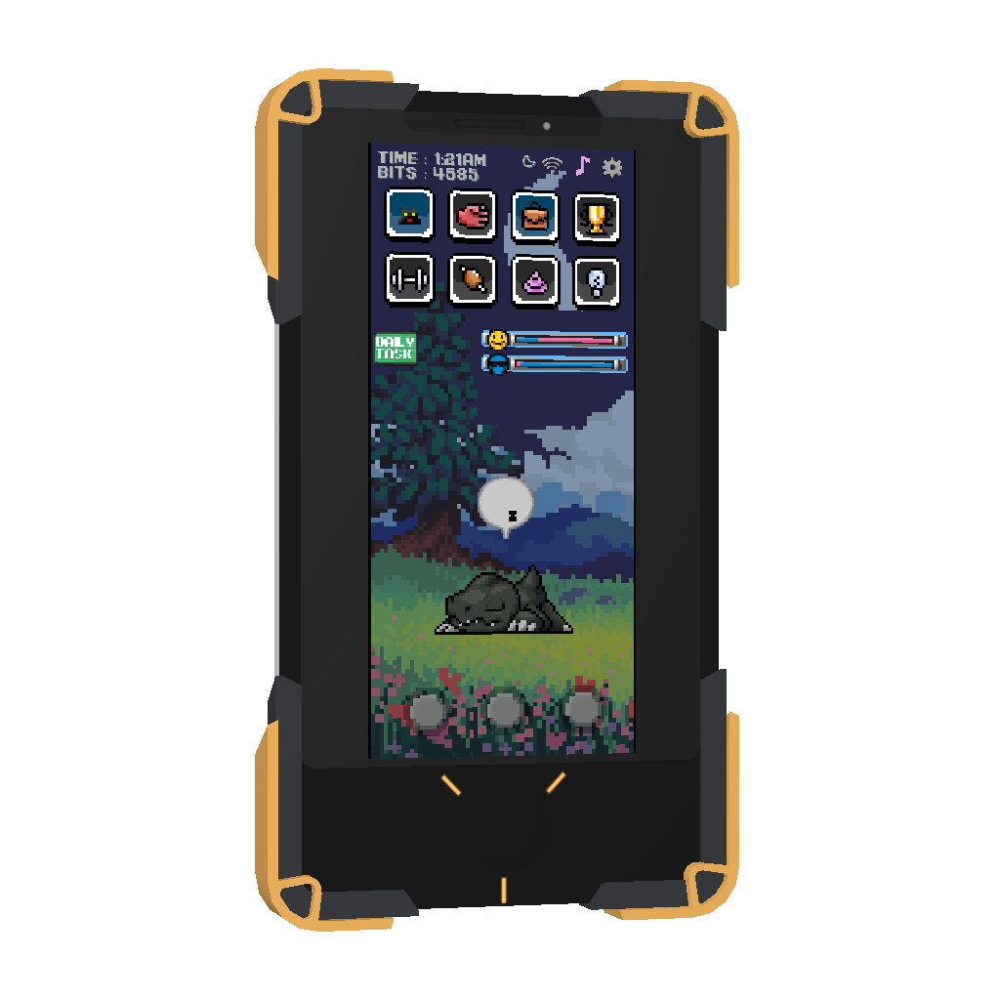
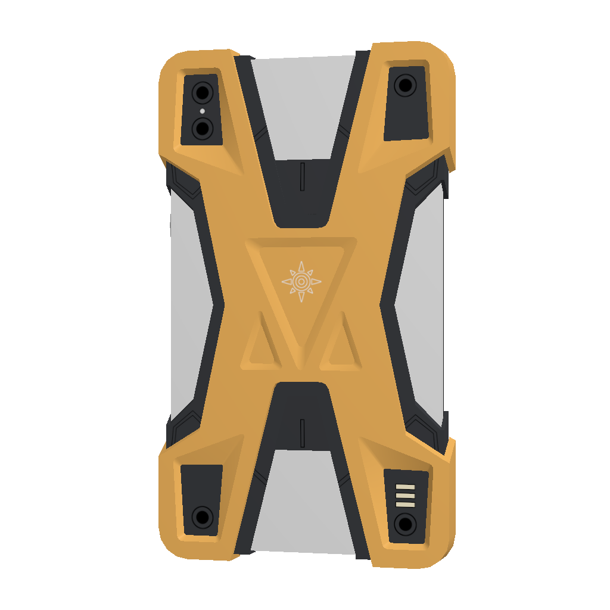

# Smartphone Digivice

A free creation for [MagicShelf](https://github.com/josethevrtech/magicshelf),
for **SteamOS and Steam Frame only**. This repository owns Smartphone Digivice’s
application code, controls, backend integration, settings and releases. Raise your
Digital Partner inside Jojogape’s Courage smartphone model.




## Development

```sh
git clone --recurse-submodules https://github.com/josethevrtech/magicshelf-smartphone-digivice.git
cd magicshelf-smartphone-digivice
./build.sh
```

Requires C++17, pkg-config, EGL/GLES3, Cairo, json-c, PipeWire, X11/XTest and
SteamVR in `/opt/steamvr`. The `vendor/magicshelf` git submodule pins SDK 1.0.0
to an exact commit. For local SDK development, set `MAGICSHELF_SDK_DIR` to a
MagicShelf checkout; normal builds use the pin. `OPENVR_LIB_DIR` can point to
the matching architecture's OpenVR SDK library during CI.

The SDK owns rendering helpers, grabbing/depth, shake recovery and dock placement.
`src/creation_profile.h` owns this creation's identity and dimensions.
`src/main.cpp`, its controls and backend helpers belong to this repository.
The initial app loop retains compile-time inactive compatibility paths from the
shared prototype; subsequent changes here do not change the other creation.

`./build.sh` compiles this creation only and runs geometry, dock and keyboard
checks. It does not start a headset session or install anything. Build output:
`build/runtime/digitalpartner-vr`. The source was extracted from the working Frame build
on 2026-10-21, including the capture identity, grab direction, shake/reset and
keyboard fixes.

## Independent packages and updates

`module.json` owns this creation's version. A matching `vX.Y.Z` tag builds an
aarch64 `.magicshelf` package, catalog, checksums and GitHub Release here.
The release does not rebuild MagicShelf or the other creation. SDK upgrades
are explicit changes to the pinned submodule.

Requires MagicShelf **0.3.2 / module API 2**. The package owns its shell and
backend lifecycle. Off stops its processes and cleans up external runtimes;
On starts it using its private data directory. Configure and return-to-dock
commands are supplied by the creation rather than hard-coded in the host.
Readiness, rollback, free subscriptions and data preservation belong to MagicShelf.

Build: `./build.sh`, then `python3 tools/package.py`.
Catalog: `https://github.com/josethevrtech/magicshelf-smartphone-digivice/releases/latest/download/catalog.json`.

### Renamed in 0.2.4

Previously named **Digivice**, this is the same creation with the same saves.
The permanent creation ID remains **`org.magicshelf.digital-partner`**.
Existing subscriptions keep their original catalog URL:
`https://github.com/josethevrtech/magicshelf-digivice/releases/latest/download/catalog.json`.
GitHub's repository redirect delivers new releases from that URL. Do not remove
and re-add the collection, change subscription records, or create another
repository at the old name; that would replace the redirect.

Package filenames, overlay keys, executable names and private data paths retain
their existing identities. The release changes the public name, description,
repository and screenshot links, and the on-device settings title. It does not
migrate or reset game saves, imported inputs, subscriptions or placement settings.
The legacy screenshot paths remain available for older published catalogs.

Runtime state is in `~/.local/share/magicshelf/module-data/` under the stable
creation ID. The old shared `Applications/DigitalPartner/vr` folder and legacy
services are not required by this package. Never run both generations together.

## First use

Subscribe and download in MagicShelf 0.3.8 or newer. Digital Partner and the
Smartphone Digivice model are included with permission. No file import, model
conversion or terminal command is needed.

If game support is missing, choose **Set up**, then **Install with Steam**.
Finish each Steam download and return to MagicShelf. The app detects when setup
is complete. Turn the creation On to begin. Updates preserve your pet and settings.

The build fetches a checksum-pinned input archive with `python3 tools/fetch_assets.py`.
Game/model inputs are bundled separately from source licensing; see
[ASSET_CREDITS.md](ASSET_CREDITS.md). Player saves and account data are never bundled.

[Jojogape](https://x.com/jojogape) made the Smartphone Digivice model.
[Aludeku](https://aludeku.itch.io/digital-partner-digimon) made Digital Partner.
The old Season 1 icon credited [boardernerd](https://www.thingiverse.com/thing:2695824).
Their game, models, textures and recognition samples retain their original terms.

Project source is MIT licensed. Valve's OpenVR headers retain their included
license. All creations and subscriptions are free; artist support is optional.
